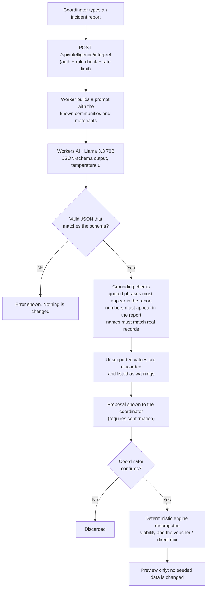
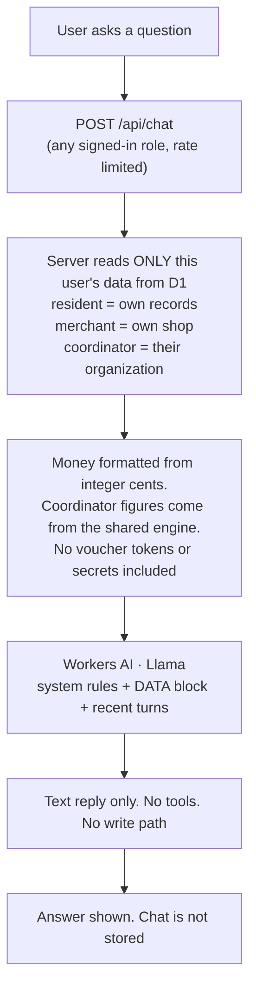
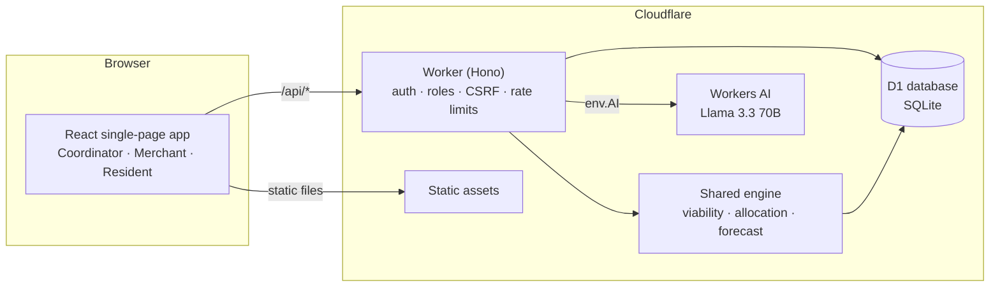

# RELAY — Emergency Aid Network

> **Assistance should reach people where it can make a difference.**

**Live application:** https://relay.rgurbani.workers.dev/

RELAY is an AI-assisted emergency aid coordination platform that connects financial assistance with local market capacity. Instead of sending every household the same kind of aid, RELAY looks at whether nearby stores can actually supply what people need, and recommends a mix of **vouchers** (where local markets can deliver) and **direct supply** (where they cannot).

> ### ⚠️ Demonstration with synthetic data
> Everything in this project is **synthetic demonstration data**: the people, merchants, communities, inventory, balances, vouchers and transactions are all invented. **No real money moves, there are no real bank or payment integrations, and no real personal information is stored.** The "Pine Valley Wildfire Response" program is fictional.
>
> **Future direction (not implemented):** the same system could be adapted so that real relief coordinators work with real data and it grows into a real product. That would require real authentication, a security and privacy review, legal and compliance work, and payment or supply partners. None of that exists today. See [Current limitations](#current-limitations).

---

## Contents

1. [Problem](#problem) · 2. [Solution](#solution) · 3. [How RELAY works](#how-relay-works) · 4. [Features](#main-features) · 5. [The three experiences](#the-three-experiences) · 6. [Allocation engine](#market-aware-aid-allocation-engine) · 7. [Workers AI](#workers-ai-features) · 8. [Forecasting](#demand-forecasting) · 9. [Scenario simulator](#scenario-simulator) · 10. [Tech stack](#technology-stack) · 11. [Architecture](#system-architecture) · 12. [Project structure](#project-structure) · 13. [Setup](#installation-and-local-development) · 14. [Configuration](#environment-variables-and-secrets) · 15. [Database](#database-setup-and-migrations) · 16. [Deploy](#deploying-to-cloudflare) · 17. [Testing](#testing) · 18. [Limitations](#current-limitations)

---

## Problem

After a disaster, aid is often delivered in one fixed form, usually cash or supplies, regardless of local conditions. Cash does little good if the stores in a community are closed or out of stock. Shipped supplies are wasteful where markets are working fine. Coordinators also have to decide quickly, with scattered information, about demand, stock levels and delayed shipments.

## Solution

RELAY gives coordinators one place to see each community's **market viability** (can local stores serve people right now?) and turns it into a recommended split between vouchers and direct supply. Residents receive vouchers they can redeem at participating local merchants. Merchants record redemptions and claim reimbursement. AI helps coordinators turn incident reports into scenarios and helps every user understand their own data, while all money and allocation calculations stay in deterministic, tested code.

## How RELAY works

1. **Assess:** for each community, the engine measures market access, merchant capacity and inventory coverage into a single viability score.
2. **Forecast:** recent consumption is projected 72 hours ahead to see where stock will run short.
3. **Recommend:** the budget is split across communities by priority, and each community's share is split into vouchers vs direct supply according to its viability.
4. **Approve:** a coordinator reviews the recommendation, with reasoning shown. Nothing is final without human approval.
5. **Issue and redeem:** residents receive vouchers; merchants redeem them through a terminal; stock, balances and reimbursement claims update in a single atomic step.
6. **Re-plan:** coordinators can simulate disruptions (a closed store, a delayed truck, new arrivals) and see the recommendation change before anything real happens.

## Main features

| Area | What it does |
|---|---|
| Market viability | Per-community score from market access, effective merchant capacity and inventory coverage |
| Allocation recommendations | Budget split by priority, and a voucher / direct-supply mix per community, with the reasoning shown |
| Demand forecasting | 3-day consumption forecast per category, evaluated against a baseline, with a projected stockout marker |
| Scenario simulator | "What if" changes, with manual controls or plain-English incident reports, previewed without changing data |
| Vouchers | Signed QR / manual codes, partial redemption, expiry, reversal entries |
| Merchant terminal | Validate and redeem vouchers (camera QR scan or typed code), with idempotent retries |
| Inventory | Stock status per merchant and category, movements recorded |
| Reimbursement | Claims created from redemptions, with approve / reject decisions recorded (no payouts) |
| Ledger and audit | Append-only ledger and audit log, enforced by database triggers |
| **Ask RELAY** | Read-only AI chat for every role that explains the signed-in user's own data |
| AI evaluation | Measured accuracy of the AI interpreter on 28 synthetic incident reports |

## The three experiences

| Role | Can do | Cannot do |
|---|---|---|
| **Coordinator** | See the program overview, communities, residents, merchants and inventory; run assessments and forecasts; simulate scenarios; approve allocations and reimbursement claims; review the audit log and reports | Pay out money (RELAY only records decisions) |
| **Merchant** | Validate and redeem vouchers at the terminal; manage own inventory; view own sales and reimbursement claims | See other merchants or any resident's records |
| **Resident** | See own balance and vouchers (with QR), find participating stores, view own activity | See anyone else's data |

All access is enforced on the server by role, and a user's role always comes from the database, never from the browser.

## Market-Aware Aid Allocation Engine

The engine lives in `shared/engine.ts`, `shared/allocation.ts` and `shared/constants.ts`. It is plain, deterministic TypeScript, and the **same code** produces the numbers on the landing preview, the coordinator console, the simulator and Ask RELAY. The weights are shown in the interface.

```
marketViability  = 0.35 × marketAccess
                 + 0.25 × effectiveCapacity
                 + 0.40 × inventoryCoverage          (each 0..1)

effectiveCapacity = averageMerchantCapacity × min(1, operatingMerchantEquivalents / merchantsNeeded)
                    (merchant status counts: open = 1, limited = 0.5, closed = 0)

voucherShare     = clamp(0.10 + 0.75 × viability, 0.10, 0.85)
directSupplyShare = 1 − voucherShare

priorityShare    = 0.40 × populationShare + 0.35 × severityShare + 0.25 × shortageValueShare
maxEligibleNeed  = people × $25 × (0.5 + severity) + projected shortage value
```

A community with healthy stores gets mostly vouchers; a community whose stores are thin or empty gets mostly direct supply. Direct-supply budgets are turned into an **estimated** procurement plan (whole units, capped at projected shortages). RELAY never purchases anything.

## Workers AI features

RELAY uses **Cloudflare Workers AI** through the `env.AI` binding. The default model is **`@cf/meta/llama-3.3-70b-instruct-fp8-fast`** (Llama 3.3 70B), configured by `AI_MODEL` in `wrangler.jsonc`. The chat can use a separate model with the optional `AI_MODEL_CHAT` variable.

| # | Feature | What the AI does | What it is NOT allowed to do |
|---|---|---|---|
| 1 | **Scenario Interpreter** (coordinator) | Reads a plain-English incident report and **extracts** a structured proposal (community, category, delay, quantity, extra residents, closed merchant) | Write to the database, issue vouchers, approve allocations. The proposal is validated and every number must appear in the report text before it is used, and a coordinator must confirm |
| 2 | **Ask RELAY chat** (all roles) | Answers questions about the signed-in user's own data in plain language | Change anything, see anyone else's data, or see voucher secrets |
| 3 | **AI Evaluation** (coordinator) | Runs the interpreter on 28 synthetic incident reports and stores the measured metrics | Claim anything about real-world accuracy |

**The AI never calculates money, viability, forecasts or allocations.** Those come from the deterministic engine above. The AI explains and extracts; code decides.

### How the Scenario Interpreter works



### How Ask RELAY works



Safeguards are enforced in code, not just in the prompt: the data context is scoped by SQL to the signed-in user, secrets are never put in it, the model has no tools, and the reply is plain text.

## Demand forecasting

Forecasting is **not** done by the AI model. It is a transparent statistical method in `shared/forecast.ts`:

- **Method:** damped-trend exponential smoothing (Holt) per community and category (α = 0.5, β = 0.2, damping φ = 0.9), projecting 24 / 48 / 72 hours.
- **Baseline:** a 7-day simple moving average, so the method has to earn its place.
- **Evaluation:** a rolling-origin holdout reports MAE and MAPE for the forecast vs the baseline.
- **Stockout:** projected hours until on-hand plus inbound stock is consumed, shown as a marker on the forecast chart.

The demand history is synthetic. These results say nothing about real-world accuracy.

## Scenario simulator

In **RELAY Intelligence → Scenario Simulator**, coordinators can apply adjustments (close or limit a merchant, delay a shipment, add residents, change inventory, scale demand) with manual controls or the AI Scenario Interpreter. The engine recomputes everything on a copy of the data and shows before and after. The simulator never writes to inventory, merchants, shipments or history; only issuing assistance, redeeming vouchers and saving scenarios or allocation runs create records. A guided **Run Pine Valley Demo** walks through the story in 8 steps.

## Technology stack

| Layer | Technology (verified in `package.json` / `wrangler.jsonc`) |
|---|---|
| Frontend | React 19, TypeScript, Vite, Tailwind CSS v4, React Router, Recharts, React Hook Form + Zod, Radix Dialog, lucide-react, `qrcode.react`, `jsqr` |
| Backend | [Hono](https://hono.dev) on [Cloudflare Workers](https://developers.cloudflare.com/workers/) |
| Database | [Cloudflare D1](https://developers.cloudflare.com/d1/) (SQLite), SQL migrations |
| AI | [Cloudflare Workers AI](https://developers.cloudflare.com/workers-ai/), Llama 3.3 70B by default |
| Hosting | Workers static assets, with the Worker running first for `/api/*` |
| Validation | Zod schemas shared by the client and the server |
| Tests | Vitest, with an in-memory SQLite (better-sqlite3) adapter that stands in for D1 |

## System architecture



Key design points:

- **Money is integer cents.** The ledger and audit log are append-only; database triggers block updates and deletes, and corrections are reversal entries.
- **Redemption is one atomic D1 batch:** voucher debit (optimistic version + CHECK constraint), inventory decrement (CHECK ≥ 0), receipt, ledger, reimbursement claim and audit entry. Idempotency keys make retries safe.
- **Voucher security:** the QR code and manual code are the same string, `VCH-<code>-<signature>`. The signature is an HMAC-SHA-256 over the public code and a per-voucher nonce, truncated, compared in constant time. The signing secret stays on the server and the credential contains no resident data.
- **Authentication:** demonstration sign-in only (see limitations). Sessions use a random token in an `HttpOnly`, `SameSite=Lax` cookie (`Secure` on HTTPS); only a SHA-256 hash of the token is stored in D1; sessions last 8 hours.
- **Request protection:** server-side role checks on every route; mutating requests need a custom client header and a matching `Origin`; rate limits on sign-in, AI, chat and terminal endpoints; Zod validation on inputs.

## Project structure

```
relay/
├── src/                  React app
│   ├── pages/            coordinator/, merchant/, resident/, Landing, SignIn
│   ├── layouts/          role layouts
│   ├── components/       UI primitives, charts, ChatPanel (Ask RELAY)
│   └── lib/              API client, auth, hooks
├── worker/               Cloudflare Worker (Hono)
│   ├── index.ts          app, middleware, route mounting
│   ├── routes/           auth, programs, communities, residents, merchants,
│   │                     inventory, intelligence, finance, portals, chat
│   ├── services/         ai.ts (interpreter), aiBenchmark.ts, chat.ts,
│   │                     redemption.ts, snapshot.ts, alerts.ts, stats.ts
│   └── lib/              auth, crypto, voucherToken, db helpers, rate limit
├── shared/               engine.ts, allocation.ts, forecast.ts, constants.ts,
│                         money.ts, schemas.ts (used by client and worker)
├── migrations/           0001_init.sql, 0002_ai_eval.sql
├── scripts/              seed generator (synthetic data)
├── seed/                 generated seed.sql (git-ignored)
├── tests/                Vitest suites
├── wrangler.jsonc        Cloudflare config (D1, AI binding, vars)
└── wrangler.dev.jsonc    local-dev config without the AI binding
```

## Installation and local development

**Requirements:** Node.js 22 or newer, and npm.

```bash
npm ci                          # install dependencies
cp .dev.vars.example .dev.vars  # local-only signing secret (never commit .dev.vars)
npm run demo:reset              # create the local database, apply migrations, load synthetic seed data
npm run dev                     # http://localhost:5173
```

- `npm run dev` needs no Cloudflare login. The AI features show as unavailable.
- To use Workers AI locally: `npx wrangler login`, then `npm run dev:ai`.
- If you reset the database while the dev server is running, restart the dev server.
- `npm ci` builds `better-sqlite3` (used only by the tests). It normally downloads a prebuilt binary; if that fails, install a C++ toolchain.

Open `/sign-in` and choose any demo profile (coordinator, merchant or resident). Demo sign-in works only while `DEMO_MODE` is `"true"`.

## Environment variables and secrets

Runtime configuration lives in Cloudflare, not in a `.env` file. See `.env.example` and `.dev.vars.example`.

| Name | Where | Purpose |
|---|---|---|
| `VOUCHER_SIGNING_SECRET` | Secret (`wrangler secret put`) or `.dev.vars` locally | HMAC key for voucher QR credentials. Use a long random value |
| `DEMO_MODE` | `wrangler.jsonc` vars | `"true"` enables the synthetic demo sign-in. Set `"false"` to disable |
| `AI_MODEL` | `wrangler.jsonc` vars | Workers AI model id (default Llama 3.3 70B) |
| `AI_MODEL_CHAT` | optional var | Separate model for Ask RELAY; falls back to `AI_MODEL` |
| `SEED_ANCHOR` | optional, seed script | Fixed anchor date for seeding (default: today, UTC) |

No API keys are stored in this repository. `.dev.vars` is git-ignored.

## Database setup and migrations

Schema changes are SQL files in `migrations/`, applied with Wrangler.

```bash
npm run db:migrate:local     # apply migrations to the local D1
npm run db:seed:local        # generate and load synthetic seed data
npm run db:reset:local       # wipe local state, migrate, seed (prompts; demo:reset skips the prompt)
npm run db:migrate:remote    # apply migrations to your Cloudflare D1
npm run db:seed:remote       # load synthetic seed data (also resets the demo data)
```

Core tables include organizations, programs, communities, merchants, residents, vouchers, inventory items and movements, redemptions, reimbursement claims, ledger entries, demand history, forecasts, scenarios, allocation runs, AI evaluation runs and audit logs. The ledger, audit log and AI evaluation tables are protected from edits and deletes by triggers.

## Deploying to Cloudflare

You need a Cloudflare account with Workers, D1 and Workers AI available.

```bash
npx wrangler login
npx wrangler d1 create relay-db        # accept the prompt to add it to your config; binding name: DB
npm run db:migrate:remote
npm run db:seed:remote
openssl rand -hex 32 | npx wrangler secret put VOUCHER_SIGNING_SECRET
npm run deploy
```

Make sure `database_id` in `wrangler.jsonc` is your real D1 id (the repository ships with a placeholder). The deploy prints your `workers.dev` URL. Set `DEMO_MODE` to `"false"` to turn off demo sign-in.

## Testing

```bash
npm test            # Vitest: engine, forecasting, financial integrity, permissions,
                    # consistency across screens, demo flow, AI grounding, chat
npm run typecheck   # TypeScript
npm run build       # production build
```

The test runner reports the exact number of tests. AI tests use **scripted mock models**, so they verify validation, grounding and safety behavior, not the quality of the real model. Real model quality is measured separately by the **AI Evaluation** tab, which needs Workers AI (`npm run dev:ai` or a deployed Worker) and reports results on synthetic reports only.

## Current limitations

**Implemented:** everything described above, on synthetic data.

**Not implemented or not claimed:**

- **No real money.** Approving allocations or claims records a decision only. There are no real bank, card, payment or payout integrations.
- **Synthetic data only.** People, merchants, inventory and history are invented. Forecast and AI results do not describe real-world accuracy.
- **Demo authentication.** Sign-in picks a synthetic profile; there are no passwords, identity verification or multi-factor authentication. A real deployment would need proper authentication.
- **Not production-ready for humanitarian use.** It has not had a security audit, legal or privacy review, accessibility audit or load testing.
- **AI can be wrong.** The interpreter is validated and requires confirmation; Ask RELAY answers from a limited data summary and can still misstate things. Check important figures in the app.
- **Rate limiting** is per Worker instance (best effort); production would add Cloudflare rate-limiting rules.
- **Camera QR scanning** needs HTTPS or localhost and camera permission; typed codes always work.
- **Requires connectivity.** It is not an offline-capable app. There is no hardware integration or blockchain functionality.

**Possible future direction (not built):** adapting RELAY for real relief coordinators with real data, which would require the items above (real authentication, security and privacy review, compliance, and payment and supply partners).

## License

No license has been chosen yet. Until one is added, all rights are reserved by the author.
